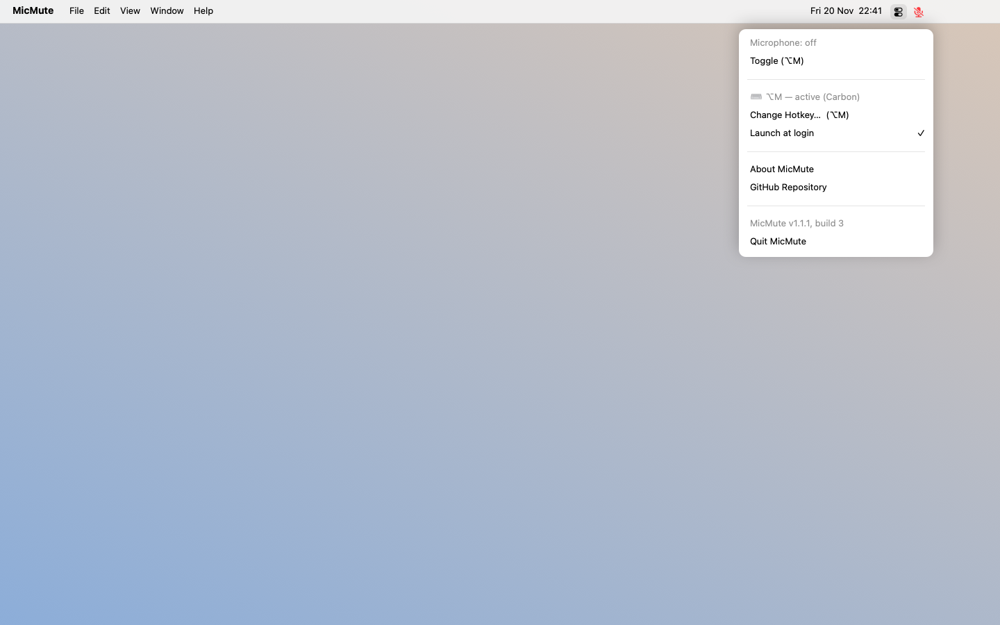

# MicMute

Menu bar app for macOS: a global hotkey toggles your microphone mute, and a status icon shows the state at a glance.

Written in Swift with zero dependencies. Global key capture uses `CGEventTap` (with automatic fallback to Carbon), microphone mute uses CoreAudio (`kAudioDevicePropertyMute`, with a volume-based fallback for devices without a mute property).

## Features

- Global hotkey (default: F5) — works in any app
- Menu bar icon: 🎤 mic on, red mic.slash when muted
- Change the hotkey to any key or combination (⌃⌥⇧⌘) from the menu
- Instant icon sync even when the system mutes the mic natively
- Launch at login (SMAppService)
- Sandbox-ready for the Mac App Store (Carbon mode, no Accessibility prompt needed)

## Screenshots

Menu bar icon + menu:



## Localization

UI is localized into 6 languages: English, Russian, Ukrainian, German, French, Spanish. The language is picked automatically from system settings (System Settings → General → Language & Region).

## Build

```bash
./build.sh     # quick: build app + deploy to /Applications + restart agent
./makedmg.sh   # full: icon + signing + styled DMG
```

Requires Xcode Command Line Tools (`xcrun swiftc`). Set your signing identity at the top of the scripts; falls back to ad-hoc.

## Install

1. Copy `MicMute.app` to `/Applications`
2. Launch once — approve the system prompt if macOS asks
3. The mic icon appears in the menu bar
4. Optional — auto start: `local.micmute.plist` into `~/Library/LaunchAgents` (build.sh does this for you)

## Usage

- **Toggle microphone** — hotkey (F5 by default) or the menu item
- **Change hotkey** — menu → "Change Hotkey…" → press any key/combination
- CLI: `MicMute --toggle` / `MicMute --status` (exit code: 0 = muted, 1 = unmuted)

## About the F1–F12 keys

In the default "special features" mode, macOS owns the F4/F5 microphone key — apps never see it. To make F5 reachable, enable System Settings → Keyboard → "Use F1, F2, etc. keys as standard function keys". Any key outside the F-row (or with modifiers) works without this setting.

## Mac App Store publication

1. Enroll in Apple Developer Program ($99/year)
2. App Store Connect → Identifiers → App ID `com.isaevdimka.micmute` (Mac)
3. Certificates → create **Apple Distribution**
4. Profiles → Mac App Store provisioning profile for the App ID → download
5. `MAS_IDENTITY="Apple Distribution: Name (TEAMID)" MAS_PROFILE=/path.provisionprofile ./mas.sh`
6. Upload `mas-build/MicMute-mas.zip` with Transporter → submit for review

The MAS build uses the app sandbox, Carbon hotkeys (no Accessibility permission) and SMAppService for login items.

## Project layout

- `src/main.swift` — the entire app (~700 lines)
- `src/Info.plist` — bundle manifest
- `makeicon.swift`, `makebg.swift` — app icon and DMG background generator
- `style-dmg.applescript` — DMG window layout
- `build.sh`, `makedmg.sh` — dev builds; `mas.sh` — App Store packaging
- `.github/workflows/build.yml` — CI

## License

MIT
